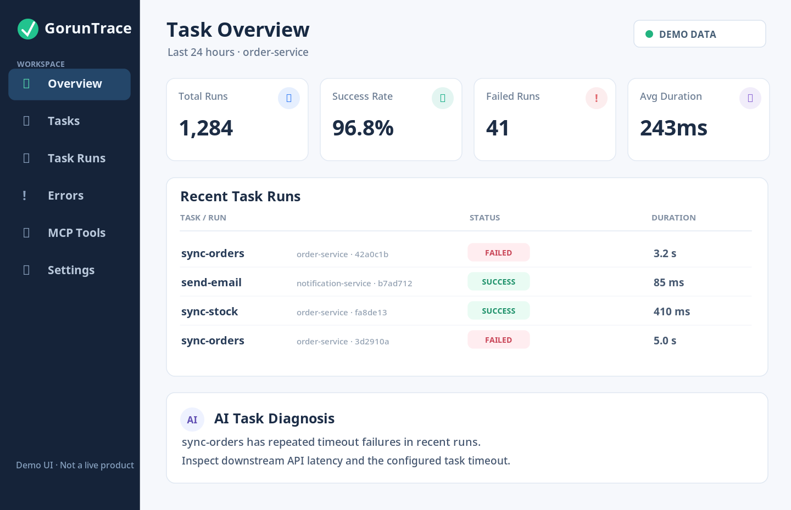

# GorunTrace — 产品与技术设计文档（v0.1）

> **定位：** AI-powered Task Observability for Go<br>
> **Slogan：** *Observe · Diagnose · Recover*<br>
> **状态：** 原始设计稿；当前目录已实现本地 MVP，实际功能与启动方式见 [README](README.md)，验证情况见 [验收记录](docs/verification.md)。本文保留原方案语境。<br>
> **源码仓库：** [Singmin/GorunTrace](https://github.com/Singmin/GorunTrace)<br>
> **预计 MVP 工期：** 7–12 个开发日（仅估算，不含生产级治理）

## 1. 项目简介

**GorunTrace** 是一个面向 Go 后端开发者的任务可观测性与调试工具。用户通过轻量级 **Go SDK** 为后台任务添加追踪，在本地 **GorunTrace Server** 查看执行历史、失败原因线索及运行指标，并通过 **MCP Server** 让 Codex、Claude 等 AI Agent 使用结构化数据辅助诊断。

**核心理念：只观察任务，不接管任务。** 不重新造一套任务队列；第一版不负责执行、调度或自动重试业务任务。

目标场景包括定时任务（Cron）、后台 Worker、业务函数（例如订单同步、邮件发送、库存同步）。未来可为 Asynq、River 等任务框架添加适配器。

### 1.1 项目价值

- **对开发者：** 用统一的 `run_id` 关联任务执行过程、耗时与错误，不必依赖零散日志。
- **对 AI Agent：** 通过受控、结构化的 MCP 工具获取真实运行数据，辅助故障定位。
- **对 Go 面试：** 展示 Goroutine、Channel、Context、HTTP、并发安全、持久化、可靠性与可观测性设计。
- **对开源社区：** 尝试“框架无关、低侵入、默认本地可运行”的开发体验，而不是复制成熟调度框架。

### 1.2 非目标（v0.1）

- 不构建通用任务队列，也不取代 Asynq / River。
- 不透明地监控任意 Goroutine；必须显式包装任务或通过适配器接入。
- 不实现完整分布式链路追踪平台；先记录任务级别的结构化事件。
- 不允许 AI 自动重跑生产任务或修改任务参数；MCP 工具默认**只读**。
- 不以“用了 Go / 加了 MCP”作为性能提升的证据；后续需要基准测试数据。

## 2. 开源竞品与差异化

| 项目 | 已有核心能力 | GorunTrace 拟采取的区别 |
|---|---|---|
| [Asynq](https://github.com/hibiken/asynq) | Redis 任务队列、任务调度、失败重试、Worker | 不另建任务队列，专注观察与诊断 |
| [Asynqmon](https://github.com/hibiken/asynqmon) | Asynq 的监控、任务管理和指标 | 不限定在 Asynq 生态 |
| [River UI](https://github.com/riverqueue/riverui) | River 任务的查看与管理 | 希望兼容普通 Go 函数和不同框架 |
| [官方 MCP Go SDK](https://github.com/modelcontextprotocol/go-sdk) | MCP 协议能力和开发基础设施 | 直接使用官方 SDK 实现诊断工具，不自行发明协议 |

> **竞品核查说明：** 表格仅用于界定已有产品类别与设计方向，不代表已完成逐条源码审计或已证实市场空白。独立开源发布前，需要继续确认类似的任务可观测性 SDK、MCP 集成项目和项目名称使用情况。

**拟验证的差异化：**“低侵入 Go SDK + 框架无关任务历史 + 只读 MCP 诊断 + 零额外服务依赖的单机体验”。是否真正具有差异，需要后续用户反馈和竞品验证。

## 3. 总体系统架构

[GorunTrace v0.1 系统架构与交付语义](docs/architecture.md)

**流程：**

1. Go 业务任务使用 SDK 的 `Trace` 接口执行并记录开始、结束、出错等事件。
2. SDK 生成 `run_id`，通过有界缓冲队列和后台 Goroutine 批量向服务端上报。
3. GorunTrace Server 验证事件、去重、入库，并提供查询和聚合接口。
4. Server 将记录保存到 SQLite（第一版的单机持久化方案）。
5. MCP Server 提供 AI 只读诊断工具；REST API 提供 Web Dashboard 数据。

### 3.1 为什么先用单机架构

SQLite 无需依赖外部 Redis / PostgreSQL，能够显著降低用户试用门槛。初期先确保采集稳定、数据语义正确、MCP 可用；若后续存在真实的高写入量、多节点部署需求，再考虑替换存储层和扩展服务架构。

## 4. Go SDK 设计

### 4.1 预期使用体验

以下是**拟实现的 API 示例**，不是现成可编译代码：

```go
client, err := goruntrace.New(goruntrace.Config{
    Endpoint: "http://localhost:8080",
    Service:  "order-service",
})
if err != nil {
    log.Fatal(err)
}
defer client.Close()

err = client.Trace(ctx, "sync-orders", func(ctx context.Context) error {
    return syncOrders(ctx)
})
```

### 4.2 SDK 内部职责

- 记录 `service`、`task_name`、`run_id`、`attempt`、任务状态、开始与结束时间和错误摘要。
- 使用 `context.Context` 传递取消与超时信号。
- 捕获 panic 以便上报诊断事件，之后**原样重新抛出**，不改变业务代码的异常语义。
- 使用**有界 Channel** 承载上报事件，通过后台 Goroutine 批量发送。
- 设置请求超时与有界重试，避免远程采集服务故障拖慢业务。
- `Close()` 有界等待缓冲事件发送；超出期限时安全退出并记录丢弃计数。
- **默认不采集密钥、Token、完整输入参数和敏感数据**；错误摘要支持过滤和脱敏。

### 4.3 需要明确的可靠性语义

- **不承诺事件零丢失**：进程崩溃、缓冲区满、网络断连都可能导致事件缺失。
- **SDK 上报与业务执行解耦**：记录失败不能改变正常业务结果。
- **允许至少一次发送**，服务端按事件 ID 幂等去重，避免重试重复计数。
- **不阻塞主任务为默认策略**：缓冲区耗尽时必须明确定义降级/丢弃行为，并暴露丢失指标。
- 时间戳建议采用 UTC，展示时由 Web UI 转换到用户本地时区。

## 5. GorunTrace Server

### 5.1 服务职责

1. **Event Ingestion：** 接收批量事件，完成参数验证、幂等去重、写入持久化。
2. **Run Query：** 根据服务、任务、状态、时间窗等维度查找执行记录。
3. **Aggregation：** 计算运行次数、失败率、延迟分布、常见错误摘要。
4. **Diagnostics：** 给 MCP 和 Dashboard 提供可追溯的结构化证据。
5. **Authentication：** 设计可选的本地模式与部署模式，远程模式需鉴权和访问控制。

### 5.2 SQLite 数据模型（草案）

| 表名 | 主要字段（示意） | 作用 |
|---|---|---|
| `services` | `id`, `name`, `created_at` | 记录接入的服务 |
| `tasks` | `id`, `service_id`, `name` | 任务定义及其所属服务 |
| `task_runs` | `run_id`, `task_id`, `status`, `attempt`, `started_at`, `ended_at`, `duration_ms`, `error_summary` | 任务执行实例及状态 |
| `task_events` | `event_id`, `run_id`, `event_type`, `occurred_at`, `payload` | 用于重建状态的原始事件 |

实际数据库迁移需要进一步约定任务状态机、索引、保留策略与并发写入策略。

### 5.3 REST API（规划）

```http
POST /api/v1/events/batch
GET  /api/v1/services
GET  /api/v1/tasks
GET  /api/v1/runs
GET  /api/v1/runs/{id}
GET  /api/v1/metrics/summary
```

建议所有列表接口支持分页和时间窗口；事件上报接口需限制请求体大小、批次数量及鉴权策略。

## 6. MCP Server（第一版）

采用官方 [MCP Go SDK](https://github.com/modelcontextprotocol/go-sdk)，第一版优先支持本地 `stdio`，以后按需求再增加 Streamable HTTP。

| 工具名称 | 输入方向 | 返回数据 |
|---|---|---|
| `list_tasks` | 服务、任务名称过滤 | 已发现的任务目录 |
| `get_task_runs` | task ID、时间窗口、分页、状态 | 执行历史 |
| `get_failed_runs` | 服务、时间范围、错误筛选 | 失败任务集合 |
| `get_run_details` | `run_id` | 单次执行及关联错误事件 |
| `analyze_task` | task ID、分析时间窗 | 失败率、耗时统计和异常模式摘要 |

**示例提问：**

> 帮我分析最近 24 小时 `order-service` 中 `sync-orders` 任务失败的原因。

AI 将先调用 MCP 查询记录，再根据错误类型和超时情况给出**可能的**诊断方向。结果不是自动确认的根因，必须保留可检查的证据。

### 6.1 MCP 安全边界

- 默认只读，不包含 `retry_job`、`delete_run` 等高风险写操作。
- 日志、错误消息与任务参数均视为不可信输入，不能作为 AI 的系统指令。
- 限制输出条数与字段，避免一次返回大量日志或敏感内容。
- 部署到远程环境时强制考虑身份鉴别、访问控制与传输安全。

## 7. Dashboard 交互草图



> **注意：** 上图是原始产品原型效果图，数字均为**模拟数据**；当前实现的 Dashboard 读取 SQLite 中的真实采集记录，详见 README。

### 7.1 首版页面

- **Overview：** 24 小时总运行次数、成功率、失败次数、平均耗时。
- **Task Runs：** 按任务、服务、状态和时间范围过滤执行历史。
- **Run Detail：** 展示开始时间、结束时间、耗时、失败摘要和事件时间线。
- **AI Diagnosis：** 引导用户通过 MCP 对接 AI 工具进行分析，不在 Web UI 中自建大模型平台。

### 7.2 展示数据举例（均为虚构）

| 指标 | 演示值 |
|---|---:|
| Total Runs | 1,284 |
| Success Rate | 96.8% |
| Failed Runs | 41 |
| Average Duration | 243 ms |

示例失败任务 `sync-orders` 多次超时，可建议检查第三方 API 延迟和任务 `Context` 截止时间。

## 8. 计划中的项目目录

```text
goruntrace/
├── cmd/
│   ├── server/             # Go HTTP 服务入口
│   └── mcp/                # MCP Server 入口
├── sdk/                    # 第三方 Go 应用可引用的 SDK
├── internal/
│   ├── api/                # REST API
│   ├── collector/          # 事件接收和批量写入
│   ├── storage/            # SQLite 数据访问
│   ├── analysis/           # 聚合和诊断
│   └── domain/             # 领域模型与状态机
├── web/                    # Vue 3 Dashboard
├── examples/
│   └── basic/              # 可运行的接入示例
├── docs/                   # 架构和操作文档
├── tests/                  # 端到端和回归测试
├── Dockerfile
├── go.mod
├── LICENSE
└── README.md
```

**技术选型：** Go 标准库 `net/http`、`context`、`log/slog`；SQLite；官方 MCP Go SDK；Vue 3；Docker。第一版采用单个 Go Module，不急于拆分微服务。

## 9. 实施路线图

| 阶段 | 预计时间 | 工作内容 | 交付物 |
|---|---:|---|---|
| Phase 1：Go SDK | 2–3 天 | 初始化仓库、Trace API、状态记录、批量上报、测试 | 可引用 SDK + 示例 |
| Phase 2：Server | 2–3 天 | SQLite 迁移、事件接收、去重、查询、统计 | 本地运行的 HTTP 服务 |
| Phase 3：MCP | 1–2 天 | 5 个只读工具、stdio、Codex/Claude 手工验证 | 可用的 MCP Server |
| Phase 4：Web & Release | 2–4 天 | Vue 页面、Docker、README、架构文档、基准测试 | v0.1 开源发布包 |

**资源不足时优先保证：SDK → Server → MCP → 测试；Dashboard 可延后。**

## 10. v0.1 验收标准

- [ ] 用户能够从 `examples/basic` 启动示例，并接入最小 Go SDK。
- [ ] 正确记录任务成功、失败、超时与 panic；业务语义不被采集层修改。
- [ ] 批量事件上报具备有界队列、超时控制和关闭等待机制。
- [ ] 对同一 `event_id` 重发不会导致重复计数。
- [ ] 任务查询可以按服务、状态、时间窗过滤且支持分页。
- [ ] MCP 能读取真实失败执行，并返回可核对的证据。
- [ ] 密钥、Token、敏感任务参数默认不被收集。
- [ ] 核心包有单元测试，关键事件流有集成测试。
- [ ] 提供 Docker 启动方式、README、架构图和简短操作录屏/GIF（后续制作）。
- [ ] 提供 Go SDK 开销、事件上报吞吐等基准测试，明确硬件与方法，不虚构速度提升。

## 11. Go 面试技术问题清单

1. SDK 为什么使用有界 `Channel`，而不是每次执行同步发 HTTP？
2. 队列满后应该丢弃、阻塞还是溢写磁盘？取舍是什么？
3. `context.Context` 如何传递取消与截止时间？如何避免 Goroutine 泄漏？
4. 如何在不吞掉 panic 的情况下记录异常？
5. 如何处理 SDK 上报失败、网络超时和服务器不可用？
6. 如何设计 `event_id` 去重和事件状态机？
7. SQLite 在多连接并发写入下的特点与约束是什么？
8. 如何给 API 做分页、索引和时间窗查询？
9. 如何避免采集层影响业务吞吐？怎样做 p95 延迟和基准测试？
10. MCP 工具为什么默认只读？如何处理提示注入与敏感数据泄露？

## 12. 近期行动清单

**建议从最小端到端链路开始：**

1. 确定 `goruntrace` 仓库与模块路径，新增 `go.mod`、许可证和 CI。
2. 完成 `Trace(ctx, taskName, fn)` 的语义定义与事件结构。
3. 编写一个真实的 `sync-orders` 示例，模拟成功、超时和错误。
4. 实现服务端事件接收、SQLite 持久化及查询。
5. 接入 MCP，通过 AI 查询最近失败任务。
6. 最后实现 Dashboard 和发布文档。

---

### 文档与图片说明

- `docs/architecture.md`：实现架构与交付语义，含 Mermaid 图。
- `dashboard-mockup.png`：原始 Dashboard 示意（模拟数据）。
- 当前目录未提供原方案提到的 `assets/*.svg` 或架构 PNG，请以实际文件和 README 为准。

*版本：v0.1 Design Draft · 2026-10-27*
