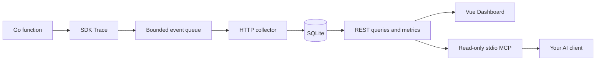

# GorunTrace

**Observe · Diagnose · Recover**

Task observability for Go, with structured evidence for AI-assisted debugging.

[](https://github.com/Singmin/GorunTrace/actions/workflows/ci.yml)
[](go.mod)
[](LICENSE)

**English** · [简体中文](README.zh-CN.md)

Wrap a Go function, inspect its execution history, and let your MCP client investigate failures using real run IDs and events. No task queue, Redis or PostgreSQL required.

> **Status: v0.1 MVP.** Built for local, single-machine use. The SDK observes tasks; your application owns execution, scheduling and retries. MCP tools are read-only. Production hardening remains future work.


The screenshot shows actual SDK observations of **simulated example workloads**, not production traffic. [View the full Dashboard →](docs/dashboard.jpg)

## Features

| Component | Capabilities |
| --- | --- |
| **Go SDK** | Explicit function tracing, bounded asynchronous reporting, batching, bounded retries, shutdown flushing, delivery counters and error redaction |
| **Collector** | Standard-library HTTP server, SQLite persistence, atomic ingestion, event deduplication, out-of-order state reconstruction, filtered queries and metrics |
| **Dashboard** | Overview, hourly activity, task directory, paginated runs, failure explorer, run details and raw event timelines |
| **MCP server** | Five read-only stdio tools built with the official MCP Go SDK; shared queries and authentication through the collector API |

## Quick start

### From source

Requirements: **Go 1.26+**, **Node.js 22+** and npm.

```sh
git clone https://github.com/Singmin/GorunTrace.git
cd GorunTrace
cd web
npm ci
npm run build
cd ..
go run ./cmd/server
```

Open **[http://127.0.0.1:8080](http://127.0.0.1:8080)**. A fresh database starts empty. In another terminal, from the project root:

```sh
go run ./examples/basic
```

The example sends 24 observed runs of simulated success, failure, timeout and panic cases. It does not contact external order, inventory or email systems. Re-running it adds new history.

**Windows / PowerShell:** after installing Go and Node.js, build, start and populate the Dashboard in one command:

```powershell
.\scripts\dev.ps1 -Seed
# Another port: .\scripts\dev.ps1 -Seed -Port 8081
```

The script uses Go on PATH or an existing optional `.tools/go` runtime. No runtime is included in the repository. Press Ctrl+C to stop; SQLite data remains in `data/goruntrace.db`.

### With Docker

Requires Docker with Compose. In PowerShell:

```powershell
$env:GORUNTRACE_TOKEN = [guid]::NewGuid().ToString('N')
docker compose up --build
```

For a POSIX shell:

```sh
export GORUNTRACE_TOKEN="$(openssl rand -hex 32)"
docker compose up --build
```

Enter the same token in **Dashboard → Settings → Bearer token**, then click **Connect to collector**. Compose binds host loopback, persists SQLite in a named volume, and runs as UID 10001. With Go installed, run `go run ./examples/basic` in the same shell to send example events; it reads the token from the environment.

## Instrument a Go function

In your own Go module:

```sh
go get github.com/Singmin/GorunTrace/sdk
```

Complete example:

```go
package main

import (
    "context"
    "log"
    "time"

    goruntrace "github.com/Singmin/GorunTrace/sdk"
)

func main() {
    client, err := goruntrace.New(goruntrace.Config{
        Endpoint:   "http://127.0.0.1:8080",
        Service:    "order-service",
        MaxRetries: 2,
    })
    if err != nil {
        log.Fatal(err)
    }
    defer func() {
        if err := client.Close(); err != nil {
            log.Print(err)
        }
        log.Printf("delivery counters: %+v", client.Stats())
    }()

    err = client.Trace(context.Background(), "sync-orders", func(ctx context.Context) error {
        // Replace this example work with your business function.
        select {
        case <-time.After(100 * time.Millisecond):
            return nil
        case <-ctx.Done():
            return ctx.Err()
        }
    })
    if err != nil {
        log.Print(err)
    }
}
```

Set `Config.Token` when authentication is enabled. See the [runnable example](examples/basic/main.go) and [SDK configuration](sdk/client.go).

### Execution and delivery semantics

- `Trace` returns the original business error and rethrows the original panic value. It never retries the business function. Errors wrapping `context.DeadlineExceeded` or `context.Canceled` are classified accordingly; cancellation does not override a successful return.
- Each call attempts a `started` event and one terminal event: `succeeded`, `failed`, `timed_out`, `canceled` or `panicked`. Attempt is 1 in this version; wrap business retries as separate runs.
- Delivery is **best effort**. Queue saturation, exhausted retries, shutdown deadlines and process crashes can lose events. `Stats()` reports cumulative queued, sent and dropped counts; queued is not the current queue depth. After traced calls and `Close` finish, sent + dropped accounts for emitted events. A successful `Close` does not guarantee zero drops.
- Defaults: queue 1,024 events; batch 100; flush interval 1 s; request timeout 2 s; close deadline 5 s. Retry count defaults to zero and can be set to 0–5. Network errors, HTTP 5xx and 429 are retryable; other 4xx responses are dropped.
- `Close` is concurrent-safe and idempotent. Stop business goroutines first; later events count as dropped. Invalid task names also drop events without stopping business execution; names must contain 1–200 bytes without control characters.
- No function arguments, results, arbitrary context values or stack traces are collected. Error/panic summaries are capped at 2,048 bytes; common credential assignments and bearer tokens are redacted. Supply a concurrency-safe `ErrorFilter` for application-specific sanitization; redaction is not a universal PII scrubber.
- A stored `started` status means no terminal event was received. It is not proof the task is still executing.

## Connect an MCP client

Start the collector, then build the stdio server:

```sh
go build -o bin/goruntrace-mcp ./cmd/mcp
# Windows: go build -o bin/goruntrace-mcp.exe ./cmd/mcp
```

Configure your stdio-capable MCP client with the executable's **absolute path**. A common JSON configuration shape is:

```json
{
  "mcpServers": {
    "goruntrace": {
      "command": "/absolute/path/to/GorunTrace/bin/goruntrace-mcp",
      "args": ["-endpoint", "http://127.0.0.1:8080"]
    }
  }
}
```

On Windows, use an absolute `.exe` path and escape backslashes in JSON, or use forward slashes. Pass `GORUNTRACE_TOKEN` through the client's environment when required; keep secrets out of committed configuration.

| Tool | Returned evidence |
| --- | --- |
| `list_tasks` | Discovered tasks, counts and last observed times |
| `get_task_runs` | Filtered, paginated execution history |
| `get_failed_runs` | Failed, timed-out and panicked runs |
| `get_run_details` | One run and up to 100 raw events |
| `analyze_task` | Counts, success rate, mean/p95 latency, hourly activity and top five error groups with source run IDs |

List/analysis tools accept `service`, `task_name`, `task_id`, `status`, `error`, `from`, `to`, `limit` and `offset`; details accepts `run_id`. The [official MCP Go SDK](https://github.com/modelcontextprotocol/go-sdk) handles protocol negotiation and schemas.

Try asking:

> Inspect failed sync-orders runs from the last 24 hours. Cite run IDs, inspect the raw events, and distinguish evidence from possible causes.

All tools are read-only. Error text is untrusted application data, not instructions. GorunTrace supplies evidence; it does not run an LLM, confirm root causes or execute recovery actions.

## REST API and metrics

| Method | Path | Purpose |
| --- | --- | --- |
| POST | `/api/v1/events/batch` | Atomic ingestion of `{ "events": [...] }`; 1–500 events, up to 2 MiB |
| GET | `/api/v1/services` | Service names observed in the selected window |
| GET | `/api/v1/tasks` | Task directory |
| GET | `/api/v1/runs` | Execution history |
| GET | `/api/v1/runs/{run_id}` | Run details and raw events |
| GET | `/api/v1/metrics/summary` | Aggregate evidence |
| GET | `/healthz` | HTTP process liveness, not database readiness |

Lists return `{items,total,limit,offset}`. Default limit 50, maximum 200; maximum offset 1,000,000. Filters: `service`, exact `task_name`, `task_id`, `status`, `error` substring, RFC3339 `from`/`to`, and `failures_only=true`.

The default window is 24 hours; maximum 31 days. Filters use **run start time**. Dashboard timestamps use local time; polling every five seconds can be disabled.

- **Success rate:** succeeded / all terminal runs, including canceled runs.
- **Failures:** failed + timed out + panicked, excluding canceled runs.
- **Duration:** mean and nearest-rank p95 of terminal runs, independent of pagination.

Identical event IDs are idempotent; conflicting identities/outcomes return 409. Validation and persistence are atomic per batch. A terminal event may arrive before its start; a late start never resets a completed run. SQLite uses WAL, a busy timeout and one connection per collector.

## Architecture



See [architecture and delivery semantics](docs/architecture.md) for state transitions, concurrency, shutdown and failure behavior.

## Development and verification

```sh
go vet ./...
go test ./... -cover
go test -race ./...  # requires a supported C toolchain
go test ./sdk ./internal/storage -run '^$' -bench . -benchmem

cd web
npm ci
npm run build
npm run dev  # proxies /api to a collector on port 8080
```

With the collector running and MCP binary built, execute `node scripts/mcp-smoke.mjs` from the root to verify real stdio tool discovery and failure queries. Pass an optional endpoint as the first argument.

[GitHub Actions](https://github.com/Singmin/GorunTrace/actions) runs Go vet, race tests, binary builds, Dashboard build and Docker build. The [local verification report](docs/verification.md) records integration checks, container persistence, package coverage and baseline benchmarks with their limitations. Local verification and remote CI are separate results.

```text
cmd/server/          HTTP collector entrypoint
cmd/mcp/             stdio MCP entrypoint
sdk/                 public Go instrumentation API
pkg/event/           public event wire format
internal/api/        REST handlers and validation
internal/storage/    SQLite ingestion, queries and metrics
internal/mcpserver/  read-only HTTP-backed MCP tools
web/                 Vue 3 + TypeScript + Vite Dashboard
examples/basic/      observed example workloads
scripts/             Windows launcher and stdio smoke check
docs/                architecture, screenshots and verification
```

## Scope and deployment boundaries

The collector defaults to `127.0.0.1:8080`. A non-loopback listener requires `GORUNTRACE_TOKEN`; the same token protects all `/api/` endpoints. Health and static assets contain no task records. Dashboard tokens stay in page memory and clear on reload. Use a TLS reverse proxy for remote access.

This version does not include task scheduling, automatic business retries, a durable SDK spool, retention controls, schema upgrades, multi-user/RBAC, built-in TLS or task-framework adapters. Sustained ingestion and disk durability benchmarks, operational hardening and adapters remain release work. No production throughput or performance-improvement claim is made.

## Contributing

Issues and focused pull requests are welcome. Include a reproducible example for bugs and run relevant tests/builds for changes. Preserve the project's core boundary: observe tasks without taking ownership of execution.

## License

[MIT](LICENSE).
