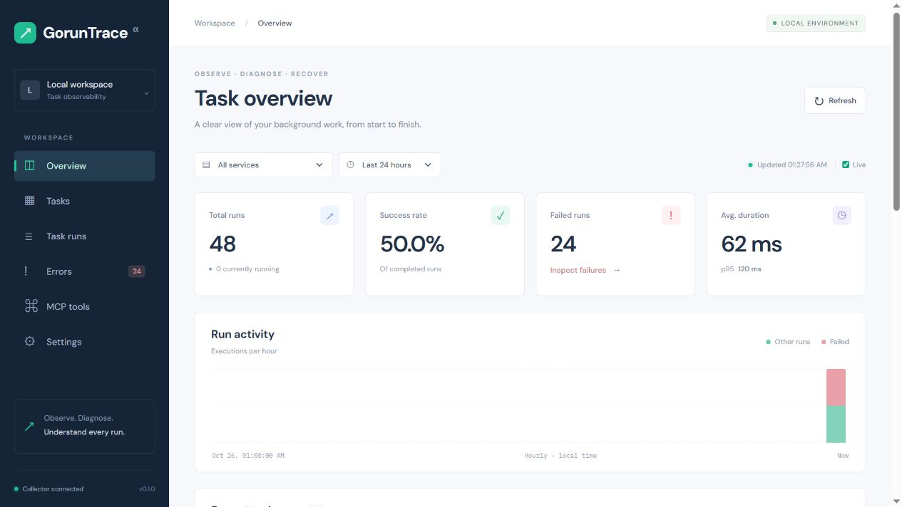

# GorunTrace

**Observe · Diagnose · Recover**

面向 Go 的任务可观测工具，为 AI 辅助排障提供可核查的执行记录。

[](https://github.com/Singmin/GorunTrace/actions/workflows/ci.yml)

[English](README.md) · **简体中文**

显式包装 Go 函数，记录执行状态、耗时与错误，在 Dashboard 查看历史，并通过 MCP 让 AI 客户端查询真实证据。无需接入特定任务队列，也无需 Redis 或 PostgreSQL。

> **当前状态：v0.1 MVP。** 适用于本地、单机开发。只观察任务，任务执行、调度和业务重试仍由应用负责。MCP 工具全部只读，生产环境治理尚待完善。



截图来自模拟业务函数的真实采集结果，并非生产数据。[查看完整截图 →](docs/dashboard.jpg)

## 已实现功能

| 组件 | 能力 |
| --- | --- |
| Go SDK | 显式追踪、有界队列、异步批量上报、有限重试、关闭等待、发送/丢弃计数与错误脱敏 |
| Collector | Go HTTP 服务、SQLite 持久化、原子写入、事件去重、乱序处理、查询和指标 |
| Dashboard | 总览、小时活动、任务目录、执行历史、筛选分页、失败列表、详情与事件时间线 |
| MCP Server | 基于官方 MCP Go SDK 的 5 个只读 stdio 工具，通过 HTTP 复用查询和鉴权 |

## 快速开始

准备 **Go 1.26+**、**Node.js 22+** 与 npm：

```sh
git clone https://github.com/Singmin/GorunTrace.git
cd GorunTrace
cd web
npm ci
npm run build
cd ..
go run ./cmd/server
```

打开 **[http://127.0.0.1:8080](http://127.0.0.1:8080)**。新数据库初始为空。在另一个终端进入项目根目录，运行：

```sh
go run ./examples/basic
```

示例执行 24 次模拟业务，覆盖成功、错误、超时和 panic，通过真实 SDK 上报；不会调用外部订单、库存或邮件系统。重复运行会追加记录。

Windows / PowerShell 可一键构建、启动和填充示例：

```powershell
.\scripts\dev.ps1 -Seed
# 更换端口：.\scripts\dev.ps1 -Seed -Port 8081
```

脚本优先使用已有 `.tools/go`，否则使用 PATH 中的 Go。仓库不包含 Go 运行时，请预先安装 Go 和 Node.js。Ctrl+C 停止服务，数据保留在 `data/goruntrace.db`。

### Docker

准备 Docker 与 Compose，在 PowerShell 中设置随机 Token：

```powershell
$env:GORUNTRACE_TOKEN = [guid]::NewGuid().ToString('N')
docker compose up --build
```

POSIX shell：

```sh
export GORUNTRACE_TOKEN="$(openssl rand -hex 32)"
docker compose up --build
```

在 Dashboard 的 **Settings → Bearer token** 输入同一个 Token，点击 **Connect to collector**。Compose 只绑定宿主机回环地址，以命名卷持久化 SQLite，容器用户为 UID 10001。同一终端中安装 Go 后，可运行 `go run ./examples/basic`；示例读取环境中的 Token。

## 接入 SDK

在你的 Go Module 中安装：

```sh
go get github.com/Singmin/GorunTrace/sdk
```

导入 `goruntrace "github.com/Singmin/GorunTrace/sdk"`，将以下片段放入已有业务函数：

```go
client, err := goruntrace.New(goruntrace.Config{
    Endpoint:   "http://127.0.0.1:8080",
    Service:    "order-service",
    MaxRetries: 2,
})
if err != nil {
    return err
}
defer client.Close() // 先等待业务 goroutine 结束，再关闭采集客户端

return client.Trace(ctx, "sync-orders", func(ctx context.Context) error {
    return syncOrders(ctx)
})
```

完整示例见 [英文 README](README.md#instrument-a-go-function) 和 [examples/basic](examples/basic/main.go)。启用鉴权时设置 `Config.Token`。

- 保留业务原始错误与 panic 值，不会自动重试业务函数。返回包装了 `context.DeadlineExceeded` 或 `context.Canceled` 的错误时，分别标记为超时或取消；不会将成功返回改为失败。
- 每次调用尝试发送开始事件与一个结束事件：`succeeded`、`failed`、`timed_out`、`canceled` 或 `panicked`。attempt 当前为 1，业务重试作为独立调用记录。
- 默认队列 1,024 个事件、批次 100 个、刷新间隔 1 秒、请求超时 2 秒、关闭期限 5 秒。上报重试默认 0 次，可设置为 0–5 次；网络错误、HTTP 5xx 和 429 可重试。
- 交付是 **best effort**：队列满、重试耗尽、关闭超时和进程崩溃均可能丢失事件。`Stats()` 提供累计 queued、sent、dropped；queued 不是队列深度，`Close()` 无错误不代表零丢弃。
- `Close()` 并发安全且幂等，关闭后事件计入 dropped。无效任务名称只丢弃采集事件，不阻止业务执行；名称需为 1–200 字节且不含控制字符。
- 不采集任务参数、返回值、任意 Context 值或堆栈。错误摘要最多 2,048 字节，过滤常见凭证；业务敏感数据需通过并发安全的 `ErrorFilter` 脱敏。
- `started` 只表示尚未收到结束事件，不证明任务仍在运行。

## MCP 接入

先启动 Collector，再构建：

```sh
go build -o bin/goruntrace-mcp ./cmd/mcp
# Windows: go build -o bin/goruntrace-mcp.exe ./cmd/mcp
```

在支持 stdio 的客户端中配置绝对路径。常见 JSON 配置结构：

```json
{
  "mcpServers": {
    "goruntrace": {
      "command": "/absolute/path/to/GorunTrace/bin/goruntrace-mcp",
      "args": ["-endpoint", "http://127.0.0.1:8080"]
    }
  }
}
```

Windows 使用 `.exe` 路径；JSON 反斜杠需转义，也可使用正斜杠。启用鉴权时通过客户端环境传入 `GORUNTRACE_TOKEN`，不要提交密钥。

| 工具 | 返回证据 |
| --- | --- |
| `list_tasks` | 任务目录、次数与最近观察时间 |
| `get_task_runs` | 按服务、任务、状态和时间筛选的执行历史 |
| `get_failed_runs` | 失败、超时与 panic 记录 |
| `get_run_details` | 单次详情及最多 100 个原始事件 |
| `analyze_task` | 次数、成功率、平均/p95 耗时、小时活动及带源 run ID 的错误聚合 |

示例提问：

> 分析最近 24 小时 sync-orders 的失败记录，引用 run ID 并检查原始事件，区分已观察到的证据与可能原因。

MCP 不运行大模型、不修改或自动恢复业务任务。错误文本是不可信业务数据，不能当作指令。协议与 Schema 使用 [官方 MCP Go SDK](https://github.com/modelcontextprotocol/go-sdk)。

## API 与指标

| 方法 | 路径 | 用途 |
| --- | --- | --- |
| POST | `/api/v1/events/batch` | 原子批量写入；1–500 个事件，最大 2 MiB |
| GET | `/api/v1/services` | 时间窗口内的服务 |
| GET | `/api/v1/tasks` | 任务目录 |
| GET | `/api/v1/runs` | 执行历史 |
| GET | `/api/v1/runs/{run_id}` | 详情与原始事件 |
| GET | `/api/v1/metrics/summary` | 聚合统计 |
| GET | `/healthz` | HTTP 存活检查，不等同数据库就绪检查 |

列表返回 `{items,total,limit,offset}`，默认每页 50 条，最多 200 条，offset 最大 1,000,000。支持服务、精确任务名、任务 ID、状态、错误子串、RFC3339 时间范围与 `failures_only=true`；具体参数见 [英文 API 说明](README.md#rest-api-and-metrics)。

默认最近 24 小时，最大 31 天，按开始时间筛选。成功率为成功次数除以全部已结束执行（含取消）；失败次数含错误、超时和 panic，不含取消。平均耗时和最近秩 p95 只统计已结束执行，不受分页影响。Dashboard 使用浏览器本地时间，默认每 5 秒刷新，可关闭。

相同事件 ID 与内容重复提交不会重复计数；身份或最终状态冲突返回 409。批次验证与写入保持原子性，结束事件可先到，迟到的开始事件不会覆盖最终状态。

## 开发与验证

```sh
go vet ./...
go test ./... -cover
go test -race ./...  # 需要受支持的 C 工具链
go test ./sdk ./internal/storage -run '^$' -bench . -benchmem

cd web
npm ci
npm run build
npm run dev
```

前端开发服务器将 `/api` 代理到端口 8080 的 Collector。构建 MCP 程序并启动 Collector 后，可执行 `node scripts/mcp-smoke.mjs` 验证真实 stdio 握手、工具发现和失败详情。

[GitHub Actions](https://github.com/Singmin/GorunTrace/actions) 包含 Go vet、race 测试、二进制构建、前端构建和 Docker 构建。[本地验收记录](docs/verification.md) 单独记录集成测试、容器重启持久化、覆盖率与基准限制。

## 适用边界与贡献

默认监听 `127.0.0.1:8080`；非回环地址必须配置 `GORUNTRACE_TOKEN`，所有 `/api/` 接口共用 Bearer Token。Dashboard Token 只存页面内存，刷新后清除；远程访问需自行配置 TLS 反向代理。

当前未实现调度器、业务自动重试、SDK 磁盘缓冲、自动数据保留、数据库升级、多用户/RBAC、内置 TLS 或框架适配器。持续负载测试、磁盘持久化基准与生产治理仍待完善，不宣称生产吞吐或性能提升。

欢迎可复现 Issue 和范围明确的 PR。修改需运行相关测试与构建，保持“只观察任务，不接管执行”的边界。详见 [架构与事件语义](docs/architecture.md)。

## 许可证

[MIT](LICENSE)。
