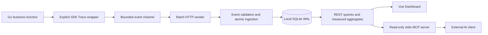

# Architecture and delivery semantics

The SDK never schedules work, retries a function, or accepts commands from the collector. MCP reads the running collector through HTTP rather than opening a second database, so authentication and query semantics are shared.

## State reconstruction

Each run has one `started` event and one terminal event. A terminal event carries the start timestamp and identity so it can stand alone if the start was lost. Ingestion handles terminal-before-start arrival. All events for a run must agree on service, task, attempt and start timestamp. A second terminal event ID conflicts; only the same event ID with identical normalized payload is idempotent. No arrival can reset a terminal run to running.

Transactions cover event deduplication, service/task discovery, run projection and raw event insertion. An invalid event, identity collision or storage error rolls the whole batch back. The API distinguishes duplicates (202), semantic conflicts (409), invalid requests (400) and storage failures (500).

If a full batch is rejected, the SDK drops the batch rather than splitting and reclassifying it. Keep business task names stable and valid. Start and terminal events are independently queued; missing either is possible. The terminal event has enough identity to reconstruct a run. Missing terminal events remain visibly incomplete; no watchdog infers a failure.

## Concurrency and shutdown

One SDK goroutine owns batching. A read/write mutex makes nonblocking enqueue and channel closure safe under concurrent Trace/Close calls. Closing rejects future events, closes the queue and allows draining. A close deadline cancels pending HTTP requests and accounts for unsent queue/batch entries. Retry attempts keep the original event IDs.

SQLite's one-connection pool serializes writes and avoids application-level writer contention. WAL supports inspecting the file from another process; this is not a multi-node architecture. Query/count operations are separate reads, so live pagination may shift while new runs arrive. Frontend requests share a fixed window and abort stale refreshes.

## Scope limits

No retention, exporter disk spool, sampling, parent spans, user tenancy, RBAC, TLS termination, task adapters, scheduler or automatic recovery. Error redaction covers common credentials, not arbitrary sensitive business text. UTC collection depends on application clocks; no cross-host clock synchronization is provided. Durations use Go monotonic elapsed time. `analyze_task` returns statistics and source evidence; an external AI client is responsible for reasoning and must treat raw messages as untrusted.
